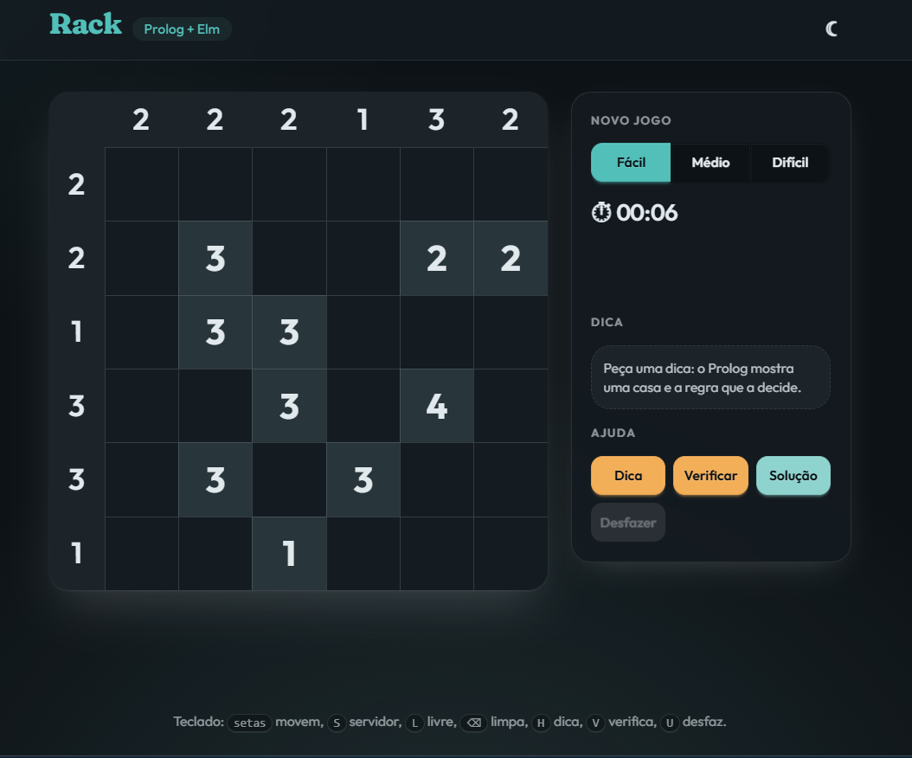

# Rack

Quebra-cabeça de lógica sobre montar um datacenter, feito em Prolog + Elm
para o trabalho final de Paradigmas de Programação (grupo Funciona na Minha
Máquina). O Prolog gera, resolve e explica os puzzles; o Elm desenha a
interface; o Python só faz a ponte entre os dois.



## Regras

Numa grade (6×6, 8×8 ou 10×10), decida em cada casa se vai um **servidor**
ou se ela fica **livre**:

1. **Carga:** o número ao lado de cada linha e acima de cada coluna diz
   quantos servidores ela tem.
2. **Sensor de calor:** uma casa com número é um sensor (nunca recebe
   servidor) e conta os servidores nas 8 casas em volta.
3. **Refrigeração:** dois servidores nunca encostam pelos lados; na diagonal
   pode.

Todo puzzle gerado tem solução única.

## Arquitetura

```
┌──────────────────────┐  HTTP/JSON  ┌──────────────────────┐  janus  ┌──────────────────────┐
│ Elm (navegador)      │ ──────────> │ Python (FastAPI)     │ ──────> │ Prolog (CLP(FD))     │
│ interface, conflitos │ <────────── │ valida o formato e   │ <────── │ regras, resolvedor,  │
│ locais, vitória      │             │ converte os dados    │         │ gerador, dica,       │
│                      │             │                      │         │ verificação          │
└──────────────────────┘             └──────────────────────┘         └──────────────────────┘
```

**Prolog** (`backend/prolog/`)

- `rack.pl`: as três regras como restrições CLP(FD), `resolver/3` e
  `contar_solucoes/3`;
- `gerador.pl`: `gerar/2` sorteia uma solução, deriva cargas e sensores e
  retira sensores enquanto a solução continuar única;
- `dica.pl`: `dica/3` acha uma casa forçada e diz qual regra a força;
  `dificuldade/2` mede o nível pelo raciocínio;
- `verificar.pl`: `verificar/3` aponta as marcas que contradizem a solução.

**Python** (`backend/app/`). `prolog.py` chama os predicados pelo
[janus](https://www.swi-prolog.org/pldoc/man?section=janus) e `main.py`
expõe as rotas com o FastAPI, validando a entrada com Pydantic. Não há
lógica de jogo aqui.

**Elm** (`frontend/src/`), na Arquitetura Elm:

- `Rack.elm`: tipos do domínio, conflitos locais e vitória, sem HTML nem HTTP;
- `Api.elm`: requisições e conversão de JSON;
- `Main.elm`: estado, teclado, cronômetro e tela;
- `View/Tabuleiro.elm` e `View/Painel.elm`: a grade e o painel lateral.

## Requisitos

- [SWI-Prolog](https://www.swi-prolog.org/Download.html) 9.2 ou mais novo,
  com o `swipl` no PATH;
- [uv](https://docs.astral.sh/uv/), que instala o Python certo sozinho;
- [Node.js](https://nodejs.org) 20 ou mais novo, com `npm`;
- `make` (no Windows, o do Git Bash, ou os comandos sem `make` abaixo).

O compilador do Elm vem pelo `npm`, em `frontend/node_modules`.

## Como rodar

```sh
make install    # dependências do backend e do frontend (uma vez só)
make dev        # backend em http://localhost:8000 e jogo em http://localhost:5173
```

Sem `make`, em dois terminais:

```sh
cd backend && uv sync && uv run fastapi dev app/main.py    # terminal 1
cd frontend && npm install && npm run dev                  # terminal 2
```

A documentação interativa da API fica em http://localhost:8000/docs.

## Como jogar

Clique numa casa para alternar entre servidor, livre e sem marca. Pelo
teclado: **setas** movem, **S** servidor, **L** livre, **⌫** limpa,
**H** dica, **V** verifica e **U** desfaz.

- **Dica:** o Prolog mostra uma casa cujo valor está forçado e destaca a
  regra que a força (linha, coluna, sensor ou refrigeração).
- **Verificar:** aponta as marcas que contradizem a solução.
- **Solução:** revela a resposta; a partida não conta como vitória.

## Testes

```sh
make test           # plunit, pytest e elm-test
make test-prolog    # só plunit (rack, gerador e dica, verificar)
make test-backend   # só pytest (rotas da API)
make test-frontend  # só elm-test
```

## Prolog direto no terminal

```
$ swipl backend/prolog/rack.pl
?- puzzle_exemplo(P), contar_solucoes(P, 10, N).

$ swipl backend/prolog/gerador.pl
?- gerar(facil, P).
```

## API

Todas as rotas recebem e devolvem JSON. O puzzle vai como `{"rows", "cols",
"rowCounts", "colCounts", "sensors"}` e as marcas como grade de inteiros
(0 sem marca, 1 servidor, 2 livre).

| Rota                 | Corpo enviado                      | Resposta                                          |
| -------------------- | ---------------------------------- | ------------------------------------------------- |
| `POST /api/generate` | `{"difficulty": "easy"}`           | `{"puzzle": {…}, "difficulty": "easy"}`           |
| `POST /api/solve`    | `{"puzzle": {…}, "marks": [[…]]}`  | `{"grid": [[…]]}`                                 |
| `POST /api/hint`     | `{"puzzle": {…}, "marks": [[…]]}`  | `{"row", "col", "value", "reason": {"kind", …}}`  |
| `POST /api/check`    | `{"puzzle": {…}, "marks": [[…]]}`  | `{"status": "ok"}` ou `{"status": "contradiction", "cells": [[r, c], …]}` |

Marcas sem solução respondem 422 com `{"detail": "mensagem"}`; `hint`
também responde 422 com o tabuleiro completo. Os detalhes estão na seção 7
do `RELATORIO.md`.

## Problemas comuns

**`ImportError: libswipl.so.9: cannot open shared object file`** ao subir o
backend ou rodar os testes. O `janus-swi` é compilado contra uma versão
específica do SWI-Prolog. Recompile ignorando o cache:

```sh
cd backend
uv sync --reinstall-package janus-swi --no-binary-package janus-swi --no-cache
```

Se o `uv sync` falhar ao instalar o `janus-swi`, quase sempre é porque ele
não achou o `swipl`: confira com `swipl --version`.

## Estrutura

```
backend/
  prolog/rack.pl            regras e resolvedor
  prolog/gerador.pl         gerador com solução única
  prolog/dica.pl            dica explicada e dificuldade
  prolog/verificar.pl       verificação das marcas
  prolog/test_*.pl          testes plunit
  app/prolog.py             ponte Python → Prolog (janus)
  app/main.py               rotas HTTP (FastAPI)
  tests/test_api.py         testes da API
frontend/
  src/Rack.elm              domínio puro
  src/Api.elm               HTTP e JSON
  src/Main.elm              Arquitetura Elm: estado, eventos, tela
  src/View/                 tabuleiro e painel
  src/style.css             visual
  tests/                    testes elm-test
Makefile                    atalhos (install, dev, test, validar)
RELATORIO.md                relatório de entrega
AVALIACAO.md                critérios de avaliação
avaliacao-360/TEMPLATE.md   template da avaliação 360 graus (entregue à parte)
scripts/validar_entrega.py  valida a forma dos documentos de entrega
```

## Entrega

A entrega é o último commit na branch `main` do repositório do grupo no
Codehood (`git push codehood main`), com o código e o `RELATORIO.md`. A
avaliação 360 graus é individual e tem uma atividade própria no Codehood:
não vai neste repositório. Antes de cada entrega:

```sh
make validar
```

O código também está no GitHub, onde o grupo desenvolveu o projeto:
https://github.com/mrodrigues14/trabalho-final-paradigmas.

O projeto partiu do modelo do professor, o Sudoku em Prolog + Elm
(https://github.com/fabiommendes/paradigmas-trabalho-final); o que foi
reaproveitado está na seção 11 do `RELATORIO.md`.
