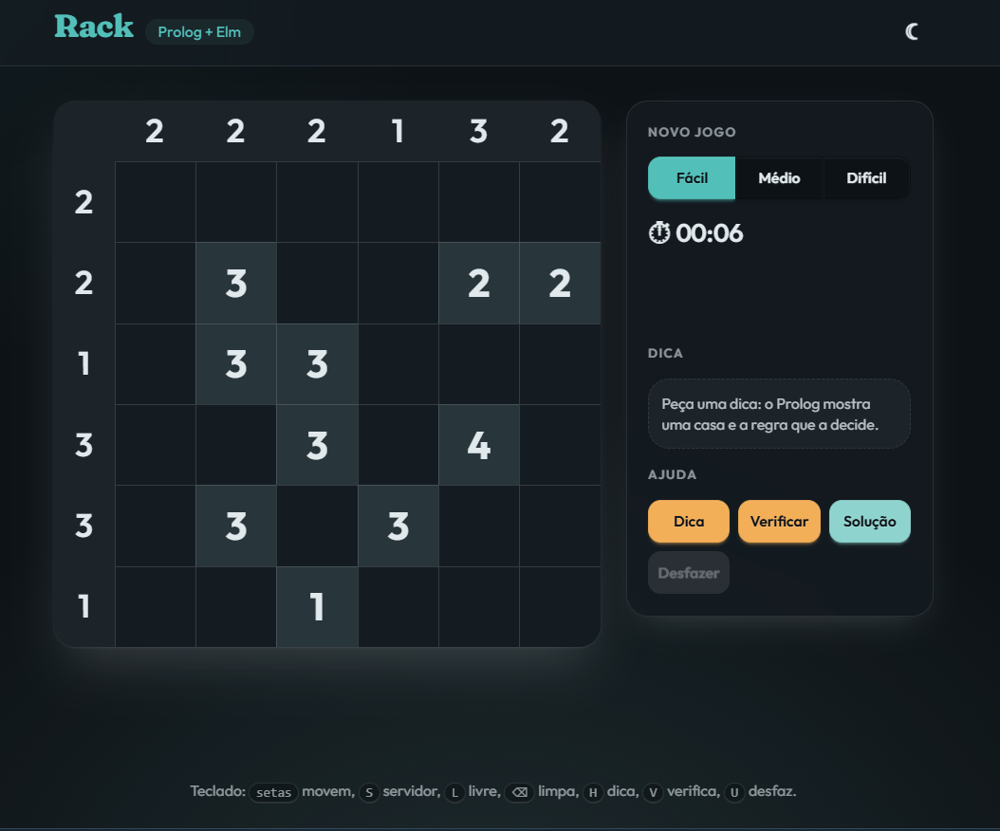
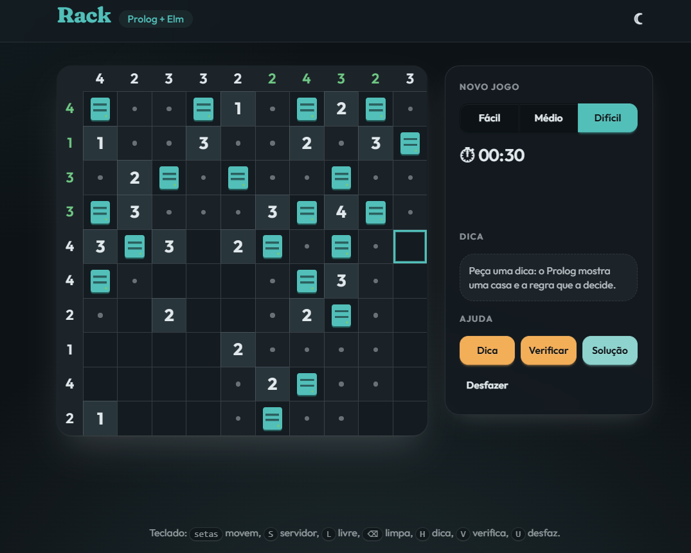

# Rack

## 1. Identificação

| Nome completo              | Matrícula | Turma (14h/16h) | Usuário GitHub  |
| -------------------------- | --------- | --------------- | --------------- |
| Anne de Capdeville         | 221031111 | 14h             | @nanecapde      |
| Bruno Cruz Garcia Rosa     | 222006605 | 14h             | @Brunocrzz      |
| Guilherme Costa Zanella    | 222024837 | 14h             | @guilhermezan42 |
| Matheus Rodrigues da Silva | 222007012 | 14h             | @mrodrigues14   |
| Nathan Batista Santos      | 222006285 | 14h             | @Nathan-bs      |

- **Nome do projeto:** Rack
- **Nome do grupo:** Funciona na Minha Máquina
- **Repositório:** [URL do repositório no Codehood, começando com https://]
- **Commit ou tag entregue:** [hash do commit final]
- **Ponto de partida:** remix original
- **Slides da apresentação oral:** não há

## 2. Resumo

Rack é um quebra-cabeça de lógica sobre montar um datacenter. Numa grade
(6×6, 8×8 ou 10×10), o jogador decide em cada casa se vai um servidor ou se
ela fica livre, respeitando três regras: a carga de cada linha e coluna, os
sensores de calor (que contam os servidores nas 8 casas em volta) e a
refrigeração (dois servidores nunca encostam pelos lados). O Prolog resolve
o que pede busca: gera puzzles com solução única, explica cada dica pela
regra que a força e aponta as marcas que contradizem a solução. O Elm cuida
da interface e da validação instantânea dos conflitos locais.





## 3. Como executar

**Requisitos** (com as versões que o grupo usou):

- SWI-Prolog 11.1.0 (9.2 ou mais novo), com o `swipl` no PATH
- Node.js 24.22.3 (20 ou mais novo), com `npm`
- uv 0.13.10, que instala o Python 3.13 e as dependências do backend
- `make` (no Windows, o do Git Bash com MSYS2, ou os comandos sem `make` abaixo)

**Instalação e execução:**

```sh
git clone <url-do-repositorio> rack
cd rack
make install    # uv sync no backend e npm install no frontend (uma vez só)
make dev        # backend em http://localhost:8000 e jogo em http://localhost:5173
```

Sem `make`, em dois terminais:

```sh
cd backend && uv sync && uv run fastapi dev app/main.py    # terminal 1
cd frontend && npm install && npm run dev                  # terminal 2
```

**Testes:**

```sh
make test           # plunit, pytest e elm-test
make test-prolog    # só plunit (rack, gerador e dica, verificar)
make test-backend   # só pytest (rotas da API)
make test-frontend  # só elm-test
```

**Testado em:** Windows 11 com [navegador e versão]; [outro sistema do teste em máquina limpa]

## 4. Arquitetura

```
┌──────────────────────┐  HTTP/JSON  ┌──────────────────────┐  janus  ┌──────────────────────┐
│ Elm (navegador)      │ ──────────> │ Python (FastAPI)     │ ──────> │ Prolog (CLP(FD))     │
│ interface, conflitos │ <────────── │ valida o formato e   │ <────── │ regras, resolvedor,  │
│ locais, vitória      │             │ converte os dados    │         │ gerador, dica,       │
│                      │             │                      │         │ verificação          │
└──────────────────────┘             └──────────────────────┘         └──────────────────────┘
```

| Parte  | Responsabilidade | Arquivos principais |
| ------ | ---------------- | ------------------- |
| Prolog | As três regras como restrições, resolvedor, contagem de soluções, gerador com solução única, dica explicada, dificuldade e verificação das marcas | `backend/prolog/rack.pl`, `backend/prolog/gerador.pl`, `backend/prolog/dica.pl`, `backend/prolog/verificar.pl` |
| Elm    | Domínio puro (tipos, conflitos, vitória), JSON e HTTP, interface e teclado | `frontend/src/Rack.elm`, `frontend/src/Api.elm`, `frontend/src/Main.elm`, `frontend/src/View/` |
| Python | Só integração: valida o formato com Pydantic, chama o Prolog pelo janus e converte listas em JSON | `backend/app/main.py`, `backend/app/prolog.py` |

O Python fica em cerca de 9% das linhas de código (295 de 3137, sem contar
os testes): 1247 linhas de Prolog e 1595 de Elm.

## 5. Parte em Prolog

### 5.1 Predicados principais

| Predicado | Local | O que faz |
| --------- | ----- | --------- |
| `rack_restricoes(+Puzzle, -Grade)` | `backend/prolog/rack.pl:6` | Cria uma variável 0..1 por casa e posta as três regras: cargas (`sum/3`), sensores e refrigeração (`A + B #=< 1`) |
| `resolver(+Puzzle, +Marcas, -Solucao)` | `backend/prolog/rack.pl:66` | Restrições, marcas do jogador como igualdades e `label/1` |
| `contar_solucoes(+Puzzle, +Limite, -N)` | `backend/prolog/rack.pl:72` | Conta até `Limite` soluções com `findall/3` e `limit/2`; com limite 2, decide a unicidade |
| `solucao_aleatoria(+L, +C, -Grade)` | `backend/prolog/gerador.pl:77` | Grade completa que respeita a refrigeração, rotulada em ordem aleatória e com densidade de 25% a 35% |
| `derivar_pistas(+Grade, -Puzzle)` | `backend/prolog/gerador.pl:134` | Calcula as cargas e põe um sensor em toda casa livre: solução única por construção |
| `enxugar(+Puzzle0, +Minimo, -Puzzle)` | `backend/prolog/gerador.pl:182` | Retira sensores em ordem aleatória, só aceitando a retirada se a solução continuar única |
| `gerar(+Nivel, -Puzzle)` | `backend/prolog/gerador.pl:247` | Junta as etapas com o tamanho de cada nível (fatos `tamanho/3`, linha 230) |
| `dica(+Puzzle, +Marcas, -[R, C, V, Motivo])` | `backend/prolog/dica.pl:66` | Uma casa aberta cujo valor está forçado, com a regra que a força |
| `resolver_com_dicas(+Puzzle, +Marcas, -Passos)` | `backend/prolog/dica.pl:256` | Resolve o puzzle seguindo só dicas, passo a passo |
| `dificuldade(+Puzzle, -Nivel)` | `backend/prolog/dica.pl:280` | Mede o nível pela proporção de passos que precisaram combinar regras |
| `verificar(+Puzzle, +Marcas, -Resultado)` | `backend/prolog/verificar.pl:38` | `ok` ou `contradicao(Casas)`: as marcas que diferem da solução única |

### 5.2 Conceitos do paradigma lógico utilizados

- [x] Fatos e regras como base de conhecimento: tamanhos e mínimos de sensores por nível (`gerador.pl:230` e `gerador.pl:240`), limiares de dificuldade (`dica.pl:273`), o que é marca errada (`verificar.pl:62`).
- [x] Unificação e casamento de padrões: a marca do jogador vira valor da casa só por unificação, `marca(1, 1)` e `marca(0, 2)` (`rack.pl:62`); o motivo da dica é traduzido cláusula a cláusula (`dica.pl:237`).
- [x] Recursão (inclusive sobre listas): `sem_encostar/1` percorre pares vizinhos (`rack.pl:53`), `rotular_aleatorio/1` (`gerador.pl:100`) e `resolver_com_dicas/3`, que chama a si mesmo com as marcas novas (`dica.pl:256`).
- [x] Backtracking e múltiplas soluções: `posicao_vizinha/5` gera os vizinhos com `member/2` (`rack.pl:38`); `regra/5` enumera as regras que passam por uma casa (`dica.pl:169`); `contar_solucoes/3` explora até duas soluções (`rack.pl:72`); `between/3` dá novas tentativas ao gerador (`gerador.pl:77`).
- [x] `findall/3`, `bagof/3`, `setof/3` ou similares: vizinhos de um sensor (`rack.pl:35`), contagem de soluções (`rack.pl:73`), casas em contradição (`verificar.pl:41`) e `aggregate_all/3` para contar passos combinados (`dica.pl:284`).
- [x] Corte (`!`) ou negação (`\+`), e por que foram necessários: em `dica.pl:88`, `\+ consistente(...)` lê-se "não existe forma de satisfazer a regra com o valor oposto", que é exatamente a definição de casa forçada; de quebra, o `\+` desfaz as restrições postas na tentativa. O `->` de `dica.pl:69` fica com a primeira casa forçada por uma regra antes de cair no caso combinado; o `!` de `gerador.pl:82` para na primeira grade aceita.
- [x] Programação por restrições (CLP(FD) ou outra): as três regras do jogo em `rack.pl:6-16`; a dica usa só a propagação de uma regra por vez (`dica.pl:185`).
- [x] Predicados de ordem superior (`maplist`, `foldl`, `include`): `maplist/2,3` postam as regras em todas as linhas e colunas (`rack.pl:11-16`), `maplist(maplist(marca))` aplica as marcas na grade (`rack.pl:60`), `foldl/4` passa o puzzle de uma retirada de sensor para a próxima (`gerador.pl:185`).
- [x] Outro: `call_with_inference_limit/3` dá um orçamento à prova de unicidade, igual em qualquer máquina (`gerador.pl:218`).

### 5.3 Trecho em destaque

```prolog
dica(Puzzle, Marcas, Dica) :-
    once(resolver(Puzzle, Marcas, Solucao)),
    grade_base(Puzzle, Marcas, Grade),
    (   forcada_por_uma_regra(Puzzle, Marcas, Grade, Dica)
    ->  true
    ;   forcada_pela_combinacao(Puzzle, Marcas, Solucao, Dica)
    ).

forcada_por_uma_regra(Puzzle, Marcas, Grade, [R, C, V, Motivo]) :-
    casa_aberta(Puzzle, Marcas, R, C),
    member(V, [1, 0]),
    Oposto is 1 - V,
    regra(Puzzle, Grade, R, C, Regra),
    \+ consistente(Grade, Regra, R, C, Oposto),
    motivo(Regra, Motivo).

consistente(Grade, Regra, R, C, Valor) :-
    casa(Grade, R, C, Valor),
    restricao(Regra, Grade, Casas),
    label(Casas).
```

(`backend/prolog/dica.pl:66-89` e `dica.pl:185-188`.)

O trecho não descreve um algoritmo de dedução: ele declara o que é uma
casa forçada. "A casa (R, C) vale V porque, se valesse o oposto, a Regra
seria impossível." O Prolog chega à resposta por backtracking sobre quatro
escolhas: a casa aberta (`casa_aberta/4`), o valor (`member/2`), a regra
que passa pela casa (`regra/5`, que enumera a linha, a coluna, os sensores
em volta e os vizinhos laterais) e, dentro de `consistente/5`, os valores
das casas daquela regra. A primeira combinação que torna a regra
insatisfazível é a dica, e a própria regra é o motivo que vai para a tela.

`consistente/5` posta **só uma regra** sobre uma grade que tem apenas as
marcas do jogador (`grade_base/3`, `dica.pl:114`). É isso que permite dizer
qual regra decidiu a casa. Quando nenhuma regra sozinha decide, o caso
`combinado` testa o puzzle inteiro com o valor oposto (`dica.pl:95`). O
`once(resolver(...))` do começo é a guarda contra marcas erradas: se as
marcas não levam a uma solução, não há dica, e a API responde 422.

O mesmo predicado, aplicado em sequência, resolve o puzzle passo a passo
(`resolver_com_dicas/3`) e mede a dificuldade pelo raciocínio
(`dificuldade/2`).

## 6. Parte em Elm

### 6.1 Modelo e mensagens

```elm
type alias Model =
    { estado : Estado, dificuldade : Dificuldade, temaEscuro : Bool }

type Estado
    = Carregando
    | Jogando Jogo
    | Vitoria Jogo
    | Falha String

type alias Jogo =
    { puzzle : Puzzle
    , selecionada : Maybe Posicao
    , dica : Maybe Dica
    , segundos : Int
    , historico : List Puzzle
    , pensando : Bool
    , aviso : Maybe String
    , revelada : Bool
    , verificacao : Maybe Verificacao
    }

type Msg
    = NovoJogo Dificuldade
    | PuzzleChegou (Result String Puzzle)
    | Clicou Posicao
    | Tecla Teclado
    | PediuDica
    | DicaChegou (Result String Dica)
    | PediuSolucao
    | SolucaoChegou (Result String (List (List Int)))
    | PediuVerificacao
    | VerificacaoChegou (Result String Verificacao)
    | Desfazer
    | Tique
    | TrocouTema Bool
    | FechouAviso

-- domínio (Rack.elm)
type Casa
    = Sensor Int
    | Aberta Marca

type Marca = SemMarca | Servidor | Livre
```

(`frontend/src/Main.elm:31-102` e `frontend/src/Rack.elm:43-96`.)

- **`Estado` é um custom type, e não um conjunto de `Bool`.** Não existe
  "carregando e com vitória ao mesmo tempo": cada tela é um construtor, e só
  `Jogando` e `Vitoria` carregam um `Jogo`. A `view` e o `update` precisam
  tratar cada caso (`Main.elm:400`, `Main.elm:239`).
- **Um sensor é `Sensor Int`, e não uma casa com `Bool` "tem sensor"**
  (`Rack.elm:58`). Assim não existe, nem por engano, um sensor marcado como
  servidor: `Marca` só aparece dentro de `Aberta`, e toda função que recebe
  uma `Casa` é obrigada pelo compilador a decidir o que fazer com o sensor.
- **`Maybe` onde algo pode faltar:** `selecionada`, a `dica` atual e a
  `verificacao`. A verificação usa o tipo `Verificacao = SemContradicao |
  Contradicao (List Posicao)` (`Api.elm:34`): a lista de casas só existe no
  caso que a tem, e `Nothing` quer dizer "ainda não verificado".
- **`Result String` em toda resposta do servidor:** `Api.elm` já entrega a
  mensagem pronta para a tela, inclusive o `detail` dos erros 422
  (`Api.elm:265`), e o `update` trata o `Ok` e o `Err` de cada pedido.
- **`Motivo` e `Conflito` são custom types** (`Rack.elm:72-86`): a interface
  destaca a linha, a coluna ou a casa certa casando o construtor
  (`View/Tabuleiro.elm:170`), sem comparar strings.

### 6.2 Conceitos do paradigma funcional utilizados

- [x] Arquitetura Elm (Model, update, view): `Main.elm:104` (`update`), `Main.elm:364` (`view`), `Main.elm:301` (`subscriptions`).
- [x] Custom types e `case` exaustivo: os tipos do domínio em `Rack.elm:47-96`; o decoder do motivo escolhe o construtor pelo campo `kind` (`Api.elm:218`); a mensagem do painel casa a tupla `(aviso, pensando, revelada)` (`Main.elm:455`).
- [x] `Maybe` e `Result` no lugar de null e exceções: `Rack.casaEm` devolve `Maybe Casa` para posições fora da grade (`Rack.elm:137`); toda requisição devolve `Result String a` (`Api.elm:265`).
- [x] Funções de ordem superior e aplicação parcial: `noJogo` recebe a função que muda o jogo (`Main.elm:239`); `mudarPuzzle (Rack.alternar posicao)` aplica parcialmente a regra do clique (`Main.elm:260`); `resolver = postarPuzzle "/api/solve" solucaoDecoder` define uma requisição por aplicação parcial (`Api.elm:52`).
- [x] Composição (`|>`, `>>`): pipelines em `Rack.conflitos` e auxiliares (`Rack.elm:294-332`), por exemplo `Tuple.first >> SensorExcedido` (`Rack.elm:315`).
- [x] Decoders e encoders JSON: `Api.elm:98-253`, com `Decode.andThen` para o motivo e a verificação.
- [x] Comandos e subscriptions (efeitos controlados): requisições HTTP como `Cmd` (`Api.elm:43-75`); teclado com `Browser.Events.onKeyDown` e cronômetro com `Time.every`, que para quando a solução é revelada (`Main.elm:301`).
- [x] Imutabilidade e atualização de records: `mudarPuzzle` cria um `Jogo` novo e empilha o puzzle antigo no histórico para desfazer (`Main.elm:260`); `Rack.mudarEm` troca uma casa devolvendo um array novo (`Rack.elm:277`).
- [x] Outro: `Rack.elm` é puro, sem `Html` nem `Http` (`Rack.elm:25-34`); `Main` e `Api` dependem dele, e não o contrário.

### 6.3 Trecho em destaque

```elm
noJogo : Model -> (Jogo -> ( Jogo, Cmd Msg )) -> ( Model, Cmd Msg )
noJogo model mudar =
    case model.estado of
        Jogando jogo ->
            let
                ( novo, cmd ) =
                    mudar jogo

                estado =
                    if not novo.revelada && Rack.venceu novo.puzzle then
                        Vitoria { novo | selecionada = Nothing }

                    else
                        Jogando novo
            in
            ( { model | estado = estado }, cmd )

        _ ->
            ( model, Cmd.none )
```

(`frontend/src/Main.elm:239-257`.)

Quase toda mensagem do jogo passa por `noJogo`: o `update` só diz **como**
o `Jogo` muda (uma função `Jogo -> ( Jogo, Cmd Msg )`), e `noJogo` cuida do
resto. Ele ignora a mensagem se não houver partida em andamento (o `_ ->`
cobre `Carregando`, `Vitoria` e `Falha`, então um clique atrasado não muda
uma tela de vitória) e confere a vitória num lugar só, depois de qualquer
mudança, seja clique, tecla, dica ou desfazer. Como `Rack.venceu` é uma
função pura do puzzle, não existe um campo "venceu" que poderia ficar
dessincronizado. Quando o jogador pede a solução, `revelada` impede que
isso conte como vitória.

## 7. Integração

O contrato está em `backend/app/main.py` (modelos Pydantic) e em
`frontend/src/Api.elm` (decoders). O puzzle vai como `{"rows", "cols",
"rowCounts", "colCounts", "sensors": [[linha, coluna, número]]}` e as marcas
como grade de inteiros (0 sem marca, 1 servidor, 2 livre). O `prolog.py`
monta o termo `puzzle/5` dentro da consulta e desmonta o motivo da dica e o
resultado da verificação com `=..` (`backend/app/prolog.py:40`,
`prolog.py:97-148`).

| Rota / chamada | Entrada | Saída | Predicado Prolog |
| -------------- | ------- | ----- | ---------------- |
| `POST /api/generate` | `{"difficulty": "easy"}` (`easy`, `medium` ou `hard`) | `{"puzzle": {…}, "difficulty": "easy"}` | `gerador:gerar/2` |
| `POST /api/solve` | `{"puzzle": {…}, "marks": [[…]]}` | `{"grid": [[…]]}` (1 = servidor); 422 se as marcas não têm solução | `rack:resolver/3` |
| `POST /api/hint` | `{"puzzle": {…}, "marks": [[…]]}` | `{"row", "col", "value", "reason": {"kind", …}}`; 422 com o tabuleiro completo ou com marcas em contradição | `dica:dica/3` |
| `POST /api/check` | `{"puzzle": {…}, "marks": [[…]]}` | `{"status": "ok"}` ou `{"status": "contradiction", "cells": [[r, c], …]}` | `verificar:verificar/3` |

## 8. Testes e validação

Tudo roda com `make test` (113 testes no total, todos passando):

| Conjunto | Arquivo | Testes | O que cobre |
| -------- | ------- | -----: | ----------- |
| plunit | `backend/prolog/test_rack.pl` | 12 | Solução do exemplo, unicidade, puzzle sem solução, marcas certas e erradas |
| plunit | `backend/prolog/test_gerador.pl` | 42 | Solução aleatória, pistas derivadas, retirada de sensores, `gerar/2`, dica por regra, dica combinada, resolução só com dicas, dificuldade |
| plunit | `backend/prolog/test_verificar.pl` | 6 | Marcas vazias, solução inteira e parcial, servidor errado, livre errado, vários erros em ordem |
| pytest | `backend/tests/test_api.py` | 15 | As 4 rotas, os 422 de regra e os 422 de validação |
| elm-test | `frontend/tests/RackTest.elm`, `frontend/tests/ApiTest.elm` | 38 | Ciclo de marcas, conflitos, vitória, textos, decoders e encoder do contrato |

Casos de borda verificados:

- **Regras:** sensor no canto, com só 3 vizinhos (`test_rack.pl:46`); sensor
  com 0; linha com carga 0; servidores encostados; diagonal permitida
  (`RackTest.elm`).
- **Unicidade:** o exemplo e todo puzzle gerado têm exatamente uma solução
  (`test_rack.pl:26`, `test_gerador.pl`); `gerar(dificil, P)` roda dentro
  do limite de tempo.
- **Dica:** o tabuleiro completo não tem dica e marcas em contradição não
  têm dica (viram 422 na API); a dica ignora casas já marcadas e bate com a
  solução.
- **Verificação:** marca 0 nunca é erro; várias casas erradas saem todas,
  em ordem de linha e coluna.
- **Entrada inválida:** marca fora de 0..2, grade de marcas do tamanho
  errado, sensor fora da grade e dificuldade desconhecida dão 422 antes de
  chamar o Prolog (`test_api.py`).
- **Interface:** clicar ou marcar num sensor não muda nada; casa sem marca
  conta como livre na vitória (`RackTest.elm`).

Também foi feito um roteiro manual no navegador: os três níveis, dica, verificar
com e sem erro, solução e vitória.

## 9. Limitações e problemas conhecidos

- **A verificação compara as marcas com a solução.** Isso só é válido
  porque todo puzzle gerado tem solução única (`verificar.pl:26-37`). Num
  puzzle com mais de uma solução, uma marca válida em outra solução seria
  acusada como errada.
- **A dificuldade medida pelo raciocínio não escolhe o nível.**
  `dificuldade/2` existe e é testado (`dica.pl:280`), mas `gerar/2` define o
  nível só pelo tamanho da grade (`gerador.pl:247`). Com mais tempo,
  sortearíamos puzzles até `dificuldade/2` bater com o nível pedido.
- **Prova de unicidade com orçamento.** Em 10×10, provar que não existe uma
  segunda solução pode demorar; quando o orçamento de inferências estoura,
  o sensor fica (`gerador.pl:218`). O puzzle nunca perde a unicidade, mas
  pode terminar com pistas a mais.
- **Tamanho máximo 10×10.** A API rejeita grades maiores
  (`backend/app/main.py:23`), porque o resolvedor fica lento.
- **Erros de validação aparecem genéricos na tela.** Os 422 de formato do
  FastAPI têm `detail` em lista, e o Elm só lê `detail` em texto, então
  mostra "Erro no servidor (código 422)" (`Api.elm:287`). Pela interface
  isso não acontece, porque o Elm sempre envia dados válidos.
- **No Windows**, o `make` não vem instalado e o `swipl` precisa estar no
  PATH para o `janus-swi`; a seção 3 tem os comandos sem `make`.

## 10. Contribuição de cada integrante

| Integrante | Principais contribuições |
| ---------- | ------------------------ |
| Matheus Rodrigues da Silva | Regras e resolvedor em Prolog (`rack.pl`: restrições CLP(FD), `resolver/3`, `contar_solucoes/3`) e testes plunit (`test_rack.pl`); plano de trabalho da equipe |
| Guilherme Costa Zanella | Gerador com solução única (`gerador.pl`), dica explicada, resolução passo a passo e dificuldade (`dica.pl`), testes plunit (`test_gerador.pl`) |
| Anne de Capdeville | Domínio Elm puro (`Rack.elm`), JSON e HTTP (`Api.elm`), testes elm-test (`frontend/tests/`) |
| Nathan Batista Santos | Interface Elm (`Main.elm`, `View/Tabuleiro.elm`, `View/Painel.elm`) e estilo (`style.css`): grade, cargas, dica, teclado, cronômetro e vitória |
| Bruno Cruz Garcia Rosa | Integração Python-Prolog (`backend/app/`), verificação (`verificar.pl`, `test_verificar.pl`), frontend ligado à API e botão verificar, testes da API, `Makefile` e relatório |

## 11. Fontes, código de terceiros e uso de IA

**Código reaproveitado.** Partimos do projeto-modelo do professor (Sudoku
em Prolog + Elm). Mantivemos a estrutura da integração Python (a forma de
`backend/app/prolog.py` e `backend/app/main.py`, com janus e FastAPI), a
configuração do Vite e do Tailwind, o `Makefile`, o `main.js` e a base do
`style.css`, adaptada ao Rack. O jogo foi escrito pelo grupo: os arquivos
`.pl` do Rack, `Rack.elm`, `Api.elm`, `Main.elm` e `View/`. Duas ideias
vêm do `sudoku.pl` do modelo: a retirada de pistas mantendo a solução única
(`dig_holes/4`, base de `enxugar/3`, `gerador.pl:181`) e a rotulagem
aleatória (`random_labeling/1`, referência para `rotular_aleatorio/1`,
`gerador.pl:100`).

**Referências.** Documentação do SWI-Prolog (CLP(FD), plunit e janus), guia
oficial do Elm e documentação dos pacotes `elm/http` e `elm/json`,
documentação do FastAPI e do Pydantic, e o material da disciplina.

**Uso de ferramentas de IA.**

- **Faixa de uso no código:** auxiliar

| Ferramenta | Para que foi usada | Como o grupo verificou o resultado |
| ---------- | ------------------ | ---------------------------------- |
| Claude Code | Gerou arquivos do backend: a verificação das marcas em Prolog e a ponte Python-Prolog com as rotas da API | O grupo revisou o código, rodou e testou cada parte, e usou a IA para explicar o que foi gerado, e não só para fazer |
| Claude Code | Gerou as mudanças do frontend que ligam a interface à API real e ao botão verificar | Revisão do código, compilação sem avisos e teste manual no navegador |
| Claude Code | Criou testes e explicou o que cada um cobre, para o grupo entender o que está sendo testado | O grupo leu os testes com a explicação da IA e rodou `make test` |
| Claude Code | Mais eficiência no desenvolvimento, resolução de bugs e ideias de escopo | Cada sugestão foi discutida pelo grupo e testada antes de entrar no código |
| Claude Code | Rascunho deste relatório a partir do código | Revisado pelo grupo, conferindo cada `arquivo:linha` |

## 12. Apresentação oral

- **Slides:** não há
- **Roteiro:**

| Parte | Duração | Quem apresenta |
| ----- | :-----: | -------------- |
| Contexto, regras do Rack e arquitetura | 2 min | Bruno Cruz Garcia Rosa |
| Demonstração: partida fácil, dica explicada, conflito, verificar e vitória | 4 min | Nathan Batista Santos |
| Prolog: as regras como restrições | 3 min | Matheus Rodrigues da Silva |
| Prolog: gerador com unicidade e dica explicada | 3 min | Guilherme Costa Zanella |
| Elm: tipos que impedem estados inválidos | 2 min | Anne de Capdeville |
| Limitações e aprendizados | 1 min | Bruno Cruz Garcia Rosa |

## 13. Reflexão sobre os paradigmas

[Parágrafo de Matheus Rodrigues da Silva sobre o Prolog das regras, com exemplo do próprio código.]

[Parágrafo de Guilherme Costa Zanella sobre o gerador e a dica, com exemplo do próprio código.]

[Parágrafo de Anne de Capdeville sobre os tipos e decoders em Elm, com exemplo do próprio código.]

[Parágrafo de Nathan Batista Santos sobre a interface em Elm, com exemplo do próprio código.]

[Parágrafo de Bruno Cruz Garcia Rosa sobre a integração e a verificação, com exemplo do próprio código.]
